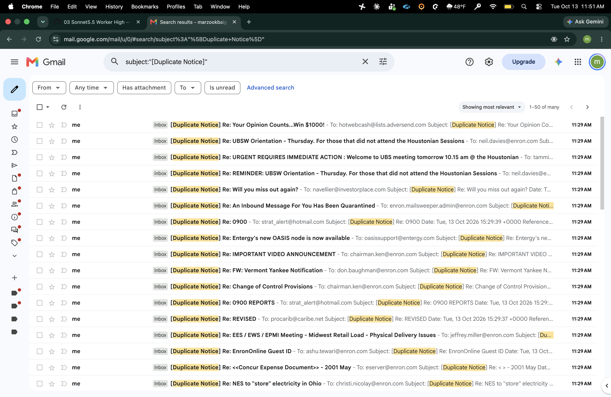
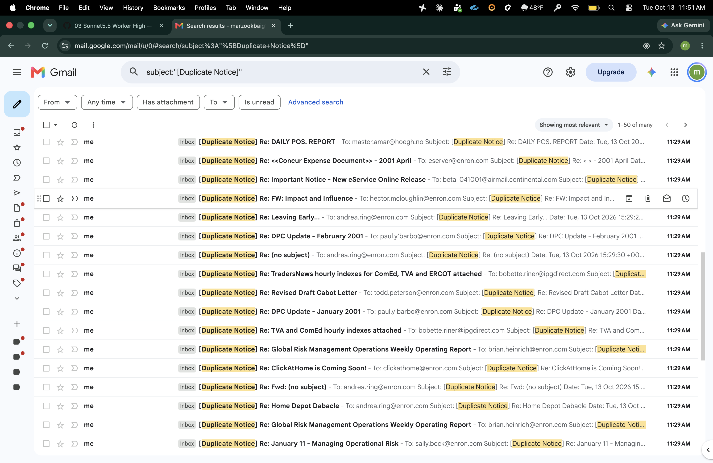
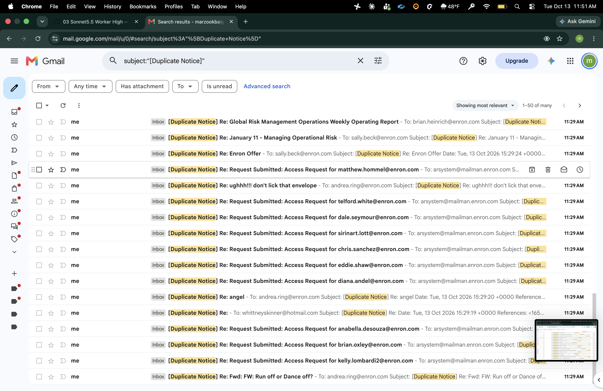
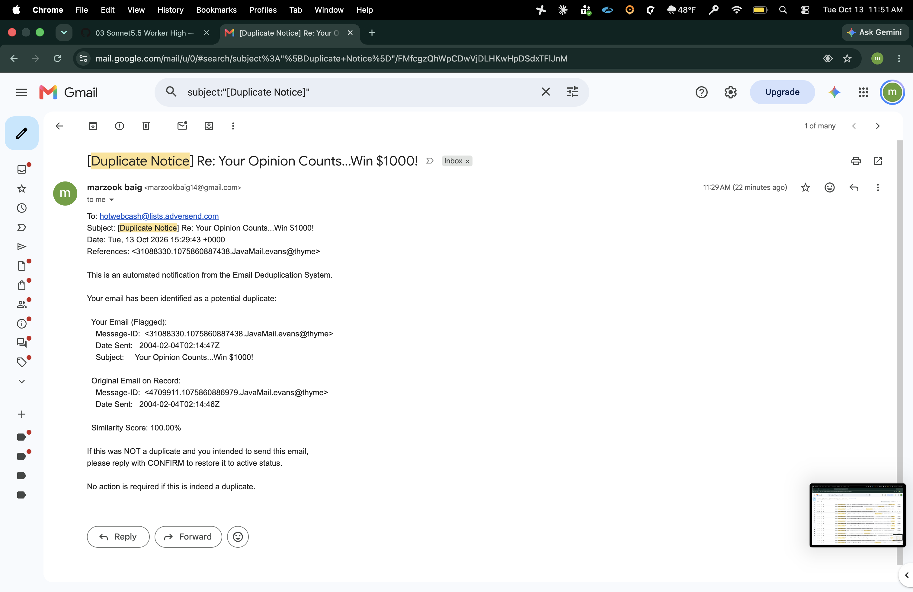
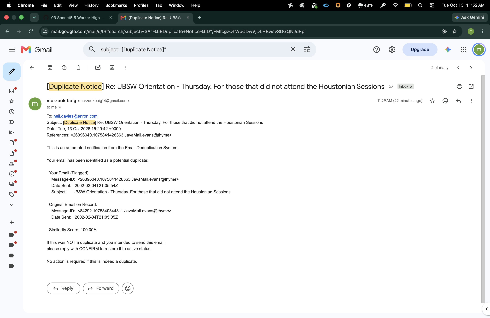
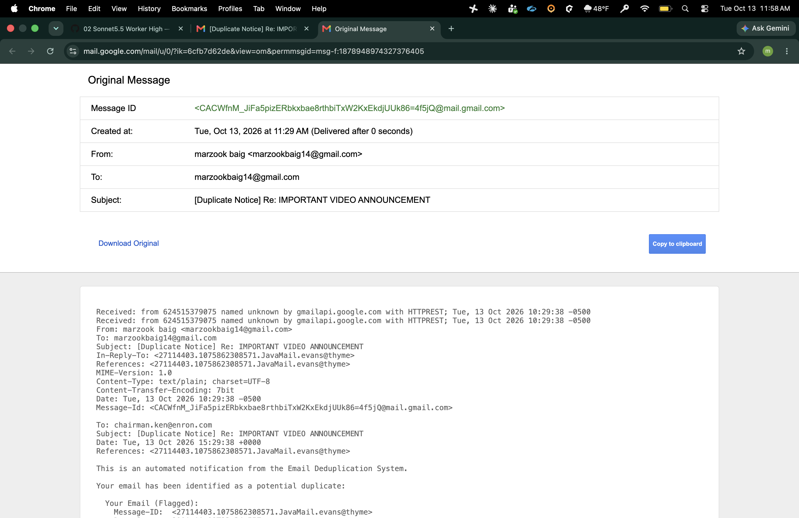
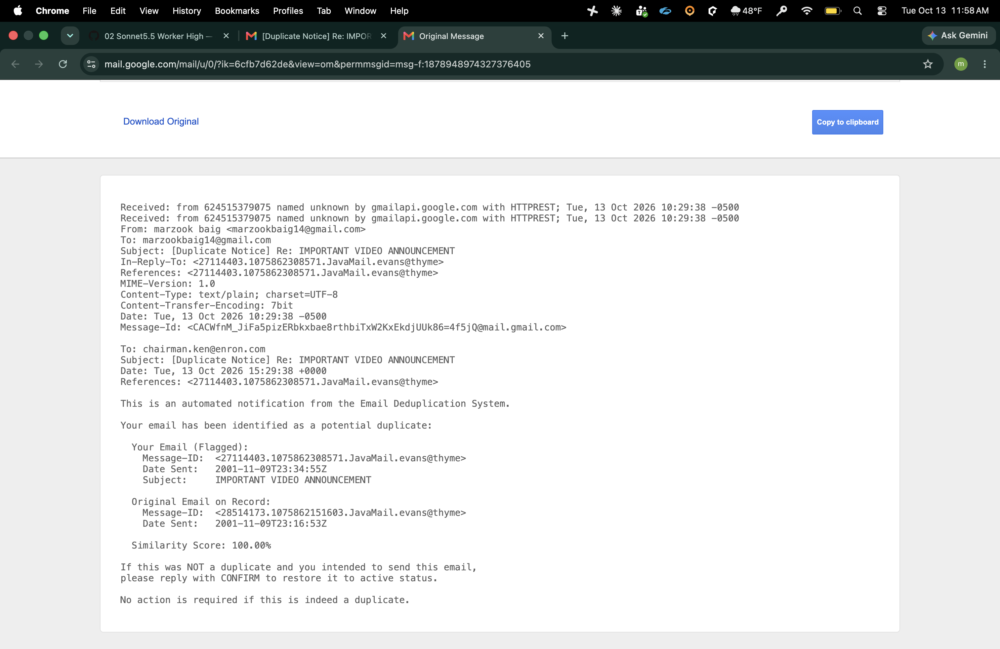

# AI usage

This file covers sections 4.3 and 6 of the assignment: how I worked with AI tools to build this project, and how I set up and used the Gmail MCP server.

**Short version:** I made the decisions, and AI wrote the code. I planned in a claude.ai chat, ran the build in parallel Claude Code sessions, logged every decision before any code was written, and checked results against the real data.

## Contents

1. Tools used
2. How I worked
3. Prompting strategy
4. Iterations and debugging
5. How I checked the AI's work
6. What I wrote vs. what AI wrote
7. Lessons learned
8. MCP integration

## 1. Tools used

| Tool | What I used it for |
|---|---|
| Claude Code 2.1.296 | All code, tests, SQL and scripts. Claude Sonnet 5.5 for the build sessions, Claude Opus for early data exploration. |
| Claude in claude.ai (one Project for this assignment) | Planning, design decisions, and drafting the prompts I gave to Claude Code. |

The version is from `claude --version` on submission day. Earlier sessions may have used an older build.

## 2. How I worked

I worked in two layers.

**Planning layer: a claude.ai chat.** I used the chat as a thinking partner. I worked through the spec there, weighed tradeoffs, and made each decision. I also asked the chat to turn my rough instructions into tight, efficient prompts for the coding agents. A good agent prompt has a specific shape (section 3), and the chat wrote that shape faster and more consistently than I could by hand. I read and edited every prompt before pasting it.

**Build layer: Claude Code.** Two Claude Code sessions ran in parallel, each owning different modules. Each prompt told the agent what the other session was building and what not to touch.

**Steering on the fly.** Not everything went through the chat. When an agent reported back, I often answered directly with short follow-ups like "proceed", "yes, add tests 15 to 17 first" or "approved, commit". When an agent raised a judgment call, I decided on the spot, or took it back to the chat if it needed more thought.

**The loop for every task:**

1. Decide in the chat.
2. Log the decision in `docs/DECISIONS.md` as a numbered entry (D-001 to D-026). The log is append-only. A change is a new entry, never an edit.
3. Paste the prompt into Claude Code. The agent reads the log first, writes tests, watches them fail, then builds.
4. The agent reports back: tests added, files changed, judgment calls, anything unfinished. It doesn't commit until I say so.
5. I review the report and the numbers, then decide the next step.

Bigger designs also got a written plan in `docs/plans/` (`module-layout.md`).

One gap: decision D-005 said to export every session into a `notes/` folder. I didn't keep that up. The raw transcripts exist in my Codespace but are not in the repo.

## 3. Prompting strategy

I never gave the whole spec at once. I went task by task, in dependency order: explore the data, choose mailboxes, design the schema, plan the modules, build the parsers, db and ingest, then dedup, notify, the command line and the docs. I cleared the session between tasks, so each one started from the written decisions instead of old chat context.

Over about 10 sessions I sent about 40 prompts. Roughly 25 were long, structured prompts. The rest were short follow-ups.

The long prompts mostly had the same five parts:

1. **Read first.** A list of files to read, and a list of files not to touch.
2. **Log the decision.** The decision text goes into the log before any code.
3. **Tests first.** Behaviors as a list. Run them, see them fail, then implement.
4. **Real-data check.** Run on a fixed-seed sample of real files and report anything odd.
5. **Report.** Tests added, files changed, judgment calls. Don't commit.

Five real examples, shortened:

**1. A full build prompt (body parser).**

> Read CLAUDE.md, docs/assignment.md, docs/DECISIONS.md, docs/plans/module-layout.md ... before doing anything. Another session is building db, discover, and ingest in parallel. Don't touch those ... PART 1: Log the decision ... re-read the file right before appending ... PART 3: Build, test first ... Run and see them fail, then implement. PART 4: Real-data check ... 30 random files (fixed seed) ... Don't commit.

Why: the decision is written before the code, so the agent builds from the log, not from a guess. The "don't touch" list and "re-read before appending" kept two parallel sessions from clashing. The real-data check found something no synthetic test would: 1,079 files with a Lotus Notes reply format the decision hadn't covered.

**2. Don't guess the tool schema (MCP sender).**

> Do NOT guess argument names. First write scripts/list_mcp_tools.py that connects, calls list_tools(), and prints each tool's name and input schema ... then build against it ... Do not run a live send yourself.

Why: an AI will happily invent plausible argument names for a tool it has never seen. Reading the real schema first removed that risk. The last line kept the one irreversible action, sending real email, in my hands.

**3. Audit first, then change (command-line options).**

> Step 1, audit only: grep the codebase for hard-coded run settings ... List each with file and line. Then propose the CLI. Step 2, implement ...

Why: I wanted to see the problem before anything changed. The audit found hard-coded file names and a second copy of the similarity threshold. It also found a real bug I hadn't asked about (case 4 below).

**4. Report first, then fix, with boundary tests (timestamp skew).**

> First, report the distribution of whole-hour gaps ... and confirm the rule below catches the 10-hour ones without catching 24-hour daily mail ... Tests first: 10h gap collapsed, 1h and 12h collapsed, 13h and 24h not collapsed ...

Why: the agent checks my proposed rule against the data before building it. Each "collapsed" test has a matching "not collapsed" test at the boundary (12h vs. 13h), so the rule can't be too wide or too narrow without a test failing.

**5. Check the state first.**

> First, check the state of the repo ... If notify is already implemented and tested (by you or anyone), don't rebuild it ...

Why: with two sessions running, I wasn't sure which one had finished notify. The agent looked first, found it already built, and rebuilt nothing.

### How the tests were written

Every module started with tests, the same way everything else started with a written decision. The prompt listed the behaviors I wanted. The agent turned each one into a test, ran the suite, and showed me the new tests failing. Only then did it write the code. A test that has never failed might not test anything.

A few habits shaped the tests:

- **Behaviors, not implementation.** Prompts described what should happen ("a 13-hour gap is not collapsed"), not how to code it.
- **Pairs at the boundary.** Each "yes" case had a matching "no" case right next to it, like 12 hours collapsed and 13 hours not. That stops a rule from being too wide or too narrow.
- **Small made-up emails.** Unit tests use short synthetic emails, so they run in seconds with no dataset. Real data was checked separately, on samples (section 5).
- **Exact output where it matters.** One golden test compares a whole notice to a fixed string, character for character.
- **No network.** The MCP sender is tested against a mocked session, so tests never send email.
- **Tests that test the tests.** The agent planted small bugs on purpose, and checked that a test failed each time (section 5).

The suite ended at 851 tests and runs in under 10 seconds.

## 4. Iterations and debugging

Four cases in detail, then some shorter ones.

### Case 1: a regex that stripped too much

**What went wrong.** The function that strips `Re:` and `Fwd:` from subjects wasn't anchored to the start of the string. So it also removed "re:" from the middle. "Update re: budget" became "update budget".

**How it was caught.** A test checking that only leading prefixes get stripped. 87 of 88 dedup tests passed, and that one failed.

**Fix.** Anchor the pattern to the start. Without that test, unrelated subjects could have been compared as duplicates, and the output would have looked fine.

### Case 2: a third of the "duplicates" were the same email twice

**What went wrong.** The first dedup run flagged 825 emails in 493 groups. Many weren't re-sends. They were the same email stored in two exports, with the Date header shifted by whole hours, usually exactly 10. Same minutes and seconds, same body. The first stage of dedup didn't treat them as copies, so the second stage flagged them.

**How it was caught.** The agent noticed the pattern, checked one pair to explain it, and asked me for a decision instead of patching it.

**What I did.** I asked for the full distribution of gaps first. 242 were exactly 10 hours. Then I set the rule: same sender, subject and body, and a gap of 1 to 12 whole hours with identical minutes and seconds. Gaps of 13 hours or more still count as re-sends, so daily automated mail is still flagged. Logged as D-023.

**Result.** Groups went from 493 to 222, and flagged emails from 825 to 540. The leftover edge cases are in the README's known limitations.

### Case 3: a bad edit duplicated a block of code

**What went wrong.** An agent edited `parse_body.py` with a script. The edit matched the wrong spot and left behind an old copy of a helper, which used a name that no longer existed.

**How it was caught.** 84 of 117 body-parser tests failed with a `NameError`.

**Fix.** The agent listed the functions in the file, found the duplicate and removed it. All 117 passed again. The tests turned a silent bad edit into an obvious failure within seconds.

### Case 4: a typo could wipe the database

**What went wrong.** The first version of the command line rebuilt the database before checking that the mailbox names were valid. So a typo like `--mailboxes beck-x` printed a clean error, but only after the old database was already deleted.

**How it was caught.** Not by a test. The agent found it during the audit step of example prompt 3, and confirmed it with a quick probe.

**Fix (D-025).** Every input is now checked before anything is created, wiped or written. The agent reran the probe, and the old database survived. This is a good example of AI code passing its own tests while still having a design hole.

### Shorter cases

- **The spec's letter vs. its intent (D-024, D-026).** The first notify build followed the spec text literally. The notice subject used the flagged email's subject instead of the original's, and could produce "Re: Re: X". Dry runs overwrote the live send log. And the body copied the Word document's blank line after every line. The first two came up in agent reports. I only saw the third in the raw source of the first live email.
- **Mailbox selection.** The first three candidate sets all landed on nearly the same large mailboxes, because the agent ranked by raw counts. It flagged this itself. I chose a stratified method instead (D-010): split all 150 mailboxes into five size groups and pick one from each.
- **Headings.** The spec's "headings" field is vague. The first rules matched 43% of all files. I tightened them twice (D-019, D-020). It's still a heuristic, and the README says so.
- **My own wrong guesses.** I wrote the placeholder address as `no_address@enron.com`. The data showed it's really `no.address@enron.com`. I was also sure four files had empty bodies. The agent checked two independent ways and showed the detector was right. My own check had treated a Windows line ending as an empty line. In both cases the agent checked my claim instead of just agreeing, which is what I want from it.

## 5. How I checked the AI's work

| Check | What it showed |
|---|---|
| Tests written first and seen failing | 851 tests. Build prompts required seeing them fail before they passed, so they test something real. |
| Breaking the code on purpose | The agent planted small bugs in the sample queries (4) and in notify (5). Each one made a test fail. |
| Exploring the real data before designing | A profile of all 517,401 files found folded headers, Lotus Notes formats, missing To headers, and that Message-IDs are all unique. So dedup had to compare content, not IDs. |
| Real-data checks after each parser | Fixed-seed samples, then whole mailboxes. This is how the Notes reply gap was found. |
| Cross-checking numbers | The selection step estimated 18,165 parsed emails. The full ingest gave exactly 18,165, with matching per-mailbox counts. |
| Checking a suspicious stat in the raw files | Cc and Bcc completeness were both exactly 30.42%. In every one of the 5,577 files with a Cc header, the Bcc header is an identical copy. It's an artifact of the Enron export, not a parser bug. |
| Reading a live email myself | I opened Gmail's raw source for the first live email and checked the headers (section 8). |
| Secret scan before commits | Every staged diff was searched for my address, tokens and keys. |

**What I did not verify.** I did not read every line of the generated code. About 60% of the Python is tests. My review focused on decisions, test names, agent reports and real data. The heading rules, the Notes formats and the 90% cutoff are judgment calls I checked on samples, not proofs.

## 6. What I wrote vs. what AI wrote

Git can't answer this, because Claude Code commits under my git identity.

| Part | Me | AI |
|---|---|---|
| Code, tests, SQL, scripts (about 12,600 lines) | 0% typed | 100% |
| Design decisions (D-001 to D-026) | the choices | the wording, mostly drafted with the claude.ai chat |
| Prompts and task breakdown | direction and edits | drafts from the claude.ai chat |
| Steering, follow-ups, reviewing and accepting work | 100% | |
| Google Cloud, OAuth and MCP setup | 100%, done by hand | the MCP client code |
| README.md and AI_USAGE.md | review and edits | drafts |

In short: the code is AI-generated. My part was the decisions, the direction, the review and the live setup.

## 7. Lessons learned

**What worked**

- **Decision log first.** Every agent read the same source of truth. It's also what made parallel sessions possible.
- **Tests first, and watching them fail.** That caught cases 1 and 3 within seconds.
- **"Report first" and "audit first".** The agents found the 10-hour skew and the database-wipe bug because I asked them to look before changing anything.
- **Asking for judgment calls.** Every report ended with "judgment calls you made". That surfaced the subject, send-log and scope issues early.
- **Using the chat to write the prompts.** Separating "decide" from "build" kept the agent prompts consistent and tight.
- **Keeping irreversible steps mine.** No agent ran a live send. I ran it, then read the headers.

**What was harder than expected**

- **Parallel sessions on shared files.** Both sessions appended to the decision log, and two decision numbers collided. The rule "re-read the file right before appending" fixed it.
- **AI builds exactly what the spec says.** The notice layout, subject and send log were faithful to the text and wrong in practice. Only a live run exposed the layout problem.
- **Numbers that moved.** Flagged emails went from 825 to 540. I had to keep asking what each number actually measured.
- **Heuristics never finish.** Headings and Notes formats have a long tail. I set cutoffs and documented the gaps.
- **Too much test code to review.** The tests are three times the size of the code. That's useful for catching regressions, but I can't honestly say I read every one.
- **Process I let slip.** Next time I'd set up session exports on day one.

## 8. MCP integration

### 8.1 Which server and why

I used the **GongRzhe Gmail MCP server** (`@gongrzhe/server-gmail-autoauth-mcp`), because:

- it's open source
- it has the `send_email` tool the assignment requires
- it runs locally over stdio, so no hosted third party sees my mail
- it refreshes the OAuth token itself, so runs don't need a fresh sign-in

### 8.2 Setup, step by step

1. Create a Google Cloud project.
2. Enable the **Gmail API** (see issue 1 below).
3. Set up the OAuth consent screen: user type External, publishing status Testing.
4. Add yourself as a test user on the Audience page (issue 2).
5. Create an OAuth client of type **Desktop app** and download the JSON.
6. Save it as `~/.gmail-mcp/gcp-oauth.keys.json`.
7. Sign in once with `npx -y @gongrzhe/server-gmail-autoauth-mcp auth`. Approve in the browser. The server saves `~/.gmail-mcp/credentials.json`.
8. Register it with Claude Code: `claude mcp add gmail --scope user -- npx -y @gongrzhe/server-gmail-autoauth-mcp`
9. Restart Claude Code and check `/mcp` (issue 5).

The pipeline doesn't need step 8. Python starts its own copy of the server and only needs the two files in `~/.gmail-mcp/`. Those files are never committed. `mcp_config.json.example` shows the server entry, with no secrets.

### 8.3 How I prompted the AI to use send_email

**A manual test through Claude Code**, to prove the setup worked:

> Use the gmail MCP send_email tool to send a test email to <my Gmail address> with subject "[Duplicate Notice] MCP test" and body "First live send from the Enron dedup pipeline setup." Show me the tool call and the result.

Claude Code called the tool and got back `Email sent successfully with ID: 1a12c54c6b0940f5`. I confirmed it in my inbox.

**Python as the MCP client**, for the pipeline itself:

> Python acts as an MCP client using the official mcp SDK (stdio transport). It launches npx @gongrzhe/server-gmail-autoauth-mcp and calls send_email. Do NOT guess argument names. First write scripts/list_mcp_tools.py ... One client session per run ... Never raise into the pipeline ... If send_email accepts inReplyTo ..., pass the duplicate's message_id there.

### 8.4 How live sending works

- **MCP is only the transport.** No model writes the emails. One function renders each notice from the spec template, and the same text goes into the `.eml` drafts and the live email.
- **Schema first.** `send_email` takes `to`, `subject` and `body`, plus optional fields like `inReplyTo`. It has no free-form headers field. So the spec's References line is sent as `inReplyTo`, and also kept as text in the body.
- **One recipient.** Enron addresses are dead, so every live notice goes to my own inbox (`--notify-to`). The notice's To line still shows the real Enron sender.
- **One notice per duplicate group**, about the latest duplicate, capped by `--limit`.
- **Failures don't stop the run.** A failed send is logged and the run moves on.
- **Tested without the network.** 30 tests use a mocked MCP session.

### 8.5 Issues and how I fixed them

| # | Issue | Fix |
|---|---|---|
| 1 | Searching "gmail mcp" in Google Cloud showed Google's own hosted MCP APIs, not the plain Gmail API. | Searched for "Gmail API" and enabled that one. |
| 2 | The credentials wizard didn't add me as a test user. | Added my account by hand on the Audience page. |
| 3 | The sign-in redirects to `localhost:3000`, but the server was running in a Codespace, not on my laptop. | It worked because Codespaces forwarded port 3000 automatically. |
| 4 | After `claude mcp add` (default local scope), gmail didn't show in `/mcp` in a new session. | Re-added it at user scope through the `/mcp` form and restarted. A later `claude mcp get gmail` showed local config, so both registrations exist and local takes precedence. The pipeline is unaffected either way. |
| 5 | A newly added server didn't appear right away. | MCP servers only load when a session starts. I restarted Claude Code. |
| 6 | The spec's References header can't be set directly, because the tool has no headers field. | Passed `inReplyTo`. Gmail's raw source showed the server set both `In-Reply-To` and `References`. |
| 7 | The first live email had a blank line between every line and no indentation. | Fixed the layout (D-026) and added an exact-match test. |

### 8.6 Evidence of live sends

**Smoke test (Oct 11).** One notice sent through the pipeline. Raw headers from Gmail's "Show original":

```
In-Reply-To: <8430921.1075855808059.JavaMail.evans@thyme>
References: <8430921.1075855808059.JavaMail.evans@thyme>
```

**Final run (Oct 13).** One notice per duplicate group:

```
$ python main.py --send-live --limit 222 --notify-to <my Gmail address>
...
Notifications (live, limit 222): 222 sent, 0 failed, delivered to <my Gmail address>; log: output/send_log.csv

$ grep -c ",sent," output/send_log.csv
222
```

Send window: 15:28:59Z to 15:29:43Z (the first and last rows of `output/send_log.csv`).

Raw headers from one received notice ("IMPORTANT VIDEO ANNOUNCEMENT"), from Gmail's "Show original":

```
In-Reply-To: <27114403.1075862308571.JavaMail.evans@thyme>
References: <27114403.1075862308571.JavaMail.evans@thyme>
```

The full log is in `output/send_log.csv`.

**Screenshots**

*1. Gmail search for `[Duplicate Notice]`: top of the results, notices from the final run (received 11:29 AM).*



*2. The same search, scrolled partway down.*



*3. The same search, scrolled to the bottom of the page.*



*4. One received notice: "Your Opinion Counts...Win $1000!".*



*5. One received notice: "UBSW Orientation".*



*6. One received notice: "IMPORTANT VIDEO ANNOUNCEMENT".*


*7. Gmail's "Show original" for the "IMPORTANT VIDEO ANNOUNCEMENT" notice: `In-Reply-To` and `References` are both set.*



*8. The same view, scrolled down to the notice body.*


