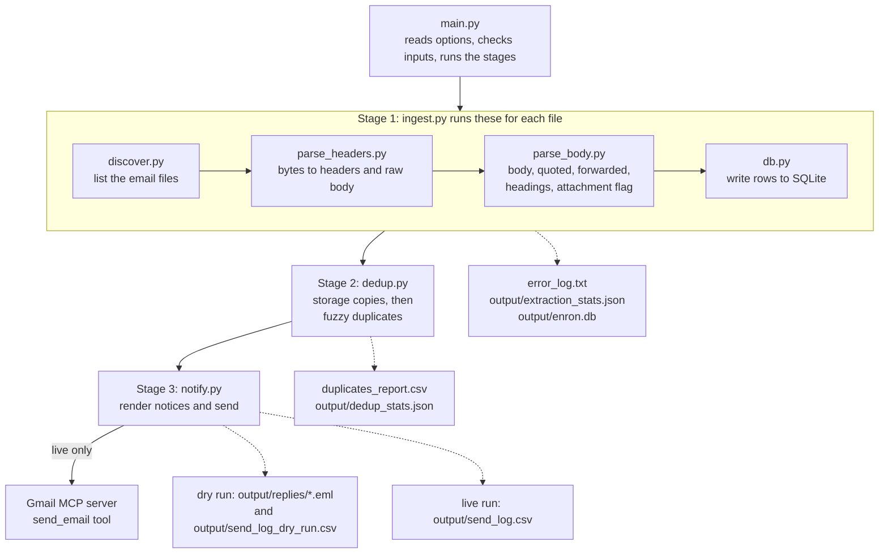

# Enron email pipeline

## Quick start

```bash
python3 -m venv .venv
source .venv/bin/activate
pip install -r requirements.txt
mkdir -p data && curl -L https://www.cs.cmu.edu/~enron/enron_mail_20150507.tar.gz | tar -xz -C data
python main.py                                                      # dry run, sends nothing
python main.py --send-live --limit 5 --notify-to you@example.com    # live run, needs the MCP setup
```

Run these from the repo root. You need Python 3.10 or newer. Live sends also need Node 18 or newer and the Gmail setup in section 4.

## Assignment checklist

Where each requirement of the assignment (`docs/ASSIGNMENT.md`, section 7 and tasks 1 to 4) is met.

| Requirement | Where |
|---|---|
| **Deliverables (section 7)** | |
| Source code | `src/enron_pipeline/` and `main.py` (section 2) |
| README.md | This file: architecture (2), setup (3), MCP setup (4), how to run (5) |
| AI_USAGE.md | [AI_USAGE.md](AI_USAGE.md): tool, prompting, debugging, what AI wrote, lessons, MCP integration |
| schema.sql | `schema.sql`, with `is_duplicate`, `duplicate_of`, `notification_sent`, `notification_date` |
| sample_queries.sql | `sample_queries.sql`: six queries, each with expected output and a real result |
| mcp_config.json.example | `mcp_config.json.example`, no secrets |
| output/replies/ | `output/replies/`: 540 `.eml` drafts, one per flagged email |
| output/send_log.csv | `output/send_log.csv`: the 222 live sends, all `sent` |
| duplicates_report.csv | `duplicates_report.csv`: 540 rows, the seven spec columns |
| error_log.txt | `error_log.txt`: 626 lines, `<file> \| <reason>` |
| requirements.txt | `requirements.txt` |
| **Task 1: extraction** | |
| 1. Find all email files | `discover.py` |
| 2. Extract mandatory and optional fields | `parse_headers.py`, `parse_body.py`; field completeness in section 9 |
| 3. Handle edge cases | Parsers and `ingest.py` never crash on bad input; the 23 edge cases are in section 6 |
| 4. Log parse failures | `error_log.txt` and the `parse_failures` table |
| 5. Extraction statistics | `output/extraction_stats.json`, also printed after ingest (section 9) |
| **Task 2: database** | |
| 6. SQLite and a schema file | `schema.sql`; the database is `output/enron.db` |
| 7. Normalized recipients | The `recipients` table: one row per To, Cc or Bcc address |
| 8. Unique `message_id` | `UNIQUE` on `emails.message_id` in `schema.sql` |
| 9. Indexes on date, sender, subject | `idx_emails_date`, `idx_emails_from_address`, `idx_emails_subject` in `schema.sql` |
| 10. Three or more sample queries | `sample_queries.sql` (six) |
| **Task 3: duplicates** | |
| 11. Scan the database after ingestion | `dedup.py`, run as stage 2 of `main.py` (section 7) |
| 12. Flag later emails, keep the earliest | Columns `is_duplicate`, `duplicate_of`, `similarity_score` (section 7) |
| 13. Groups over two: flag all but the earliest | Every later email is compared with the original; the largest group has 42 emails |
| 14. `duplicates_report.csv` | `duplicates_report.csv` |
| 15. Duplicate statistics | `output/dedup_stats.json`, also printed after dedup (section 9) |
| **Task 4: notifications via MCP** | |
| 4.1 MCP server setup and config example | Section 4; `mcp_config.json.example` |
| 4.2 Notice emails from the template | `notify.py`; drafts in `output/replies/`; live sends are one per group (section 7) |
| 16. Which server and why | AI_USAGE.md, "Which server and why" |
| 17. Setup steps | Section 4 here; AI_USAGE.md, "Setup, step by step" |
| 18. How the AI was prompted to use `send_email` | AI_USAGE.md, "How I prompted the AI to use send_email" |
| 19. Problems and fixes | AI_USAGE.md, "Issues and how I fixed them" |
| 20. Proof of a live send | `output/send_log.csv`, the screenshots in `docs/screenshots/`, and AI_USAGE.md, "Evidence of live sends" |

## 1. Overview

This project reads raw emails from the Enron dataset and turns them into structured data. It pulls out fields such as sender, recipients, date (in UTC), subject and body. It separates the new text from quoted and forwarded text. It stores everything in a SQLite database and finds duplicate emails. Then it sends a notice about each duplicate group.

It works on five chosen mailboxes (18,791 files). One command, `python main.py`, runs it all. By default it is a dry run: it writes the notices as `.eml` drafts and sends nothing. With `--send-live` it sends real emails through a Gmail MCP server. (MCP is the Model Context Protocol, a standard way for tools to call outside services.)

It was built with Claude Code. Every design choice is logged in [docs/DECISIONS.md](docs/DECISIONS.md) (D-001 to D-026). Numbers like D-021 in this README point to entries in that file.

## 2. Architecture



The code is in `src/enron_pipeline/`. Each module has one job:

| Module | What it does |
|---|---|
| `main.py` (repo root) | The command line. Reads the options, checks the inputs, runs the stages. The only place that reads the command line or the environment. |
| `models.py` | The shared record types: `EmailRecord`, `Recipient`, `DuplicateFlag`, `SendResult` and a few more. |
| `config.py` | Every default setting, in one place. |
| `discover.py` | Lists the email files in the chosen mailboxes, in sorted order. |
| `parse_headers.py` | Turns the bytes of one file into headers and a raw body. Dates become UTC. Fails the email if a mandatory field is missing. |
| `parse_body.py` | Splits the body from quoted and forwarded text. Finds headings. Flags attachments. Decodes quoted-printable text. |
| `ingest.py` | Runs the steps above for each file. Never crashes on a bad file. Writes the error log and the extraction stats. |
| `db.py` | Reads and writes SQLite. Rebuilds the database from `schema.sql` on every run. |
| `dedup.py` | Finds storage copies (one email filed in several folders), then fuzzy duplicates. Writes the report and the stats. |
| `notify.py` | Builds the notices. Has a dry-run sender (`.eml` files) and a live sender (Gmail MCP). Writes the send logs. |

The modules share only `models.py` (D-014). `ingest.py` and `main.py` connect the others. One exception: `dedup.py` calls `db.py` functions to read and write the database (D-021).

Other folders: `docs/plans/` has the module plan. `docs/exploration/` has the data exploration and the mailbox selection. `scripts/` has the exploration scripts and `list_mcp_tools.py`. `tests/unit/` has the tests.

## 3. Setup

You need:

- **Python 3.10 or newer.** It was built and tested on Python 3.14.
- **Node.js 18 or newer.** Only for live sends. The Gmail MCP server runs through `npx`.
- About 3 GB of disk for the dataset.

Install the code with one command, from the repo root. The command installs the libraries. It also installs this project's own package, because the last line of `requirements.txt` is `-e .`. `main.py` needs both.

```bash
python3 -m venv .venv
source .venv/bin/activate
pip install -r requirements.txt
```

Run it from the repo root. The `-e .` line means "this folder". Pip stops with an error if you run it from anywhere else.

Download the dataset and unpack it into `data/maildir`:

```bash
mkdir -p data
curl -L -o enron_mail_20150507.tar.gz https://www.cs.cmu.edu/~enron/enron_mail_20150507.tar.gz
tar -xzf enron_mail_20150507.tar.gz -C data
rm enron_mail_20150507.tar.gz
ls data/maildir | wc -l        # should print 150
```

The dataset has 517,401 files in 150 mailboxes. It unpacks to about 2.6 GB. The `data/` folder is ignored by git. The pipeline only reads it. It never changes it.

## 4. MCP setup

This is only needed for live sends. The server is [@gongrzhe/server-gmail-autoauth-mcp](https://www.npmjs.com/package/@gongrzhe/server-gmail-autoauth-mcp).

1. Create a project in the [Google Cloud console](https://console.cloud.google.com/).
2. Enable the **Gmail API** for the project.
3. Set up the **OAuth consent screen**. Choose user type **External**. Leave the publishing status as **Testing**. Add your own Gmail address under **Test users**.
4. Go to **Credentials** and create an **OAuth client ID** of type **Desktop app**. Download the JSON file.
5. Save the file as `~/.gmail-mcp/gcp-oauth.keys.json`:
   ```bash
   mkdir -p ~/.gmail-mcp
   mv ~/Downloads/client_secret_*.json ~/.gmail-mcp/gcp-oauth.keys.json
   ```
6. Sign in once. A browser opens. Use the test-user account. The server saves its token to `~/.gmail-mcp/credentials.json`.
   ```bash
   npx -y @gongrzhe/server-gmail-autoauth-mcp auth
   ```
7. Register the server with Claude Code:
   ```bash
   claude mcp add gmail --scope user -- npx -y @gongrzhe/server-gmail-autoauth-mcp
   ```

Check that it works:

```bash
claude mcp list                                          # gmail should say Connected
python scripts/list_mcp_tools.py --tool send_email       # prints the tool's input schema, sends nothing
```

Notes:

- The pipeline does not need step 7. `notify.py` starts the same server itself. It only needs the two files in `~/.gmail-mcp/`.
- Never commit those two files.
- Google expires the tokens of apps in Testing mode after 7 days. If sends start failing, run step 6 again.
- [mcp_config.json.example](mcp_config.json.example) shows the server entry. It holds no secrets.
- [AI_USAGE.md](AI_USAGE.md) has the full story of the MCP setup, in its MCP integration section. It tells what went wrong and how it was fixed.

## 5. How to run

Run everything from the **repo root**. The default paths are relative to it.

```bash
python main.py                          # dry run on the default five mailboxes
python main.py --mailboxes ring-a       # dry run on one mailbox

export NOTIFY_TO=you@example.com        # where live notices are delivered
python main.py --send-live --limit 5    # live run: sends at most 5 notices
```

A run on fewer mailboxes overwrites the committed outputs in your copy. To restore them, run `git checkout -- . && git clean -fd output/`. The database is not tracked, so a full `python main.py` rebuilds it.

A full default run takes about 25 to 70 seconds, depending on the machine.

| Option | Default | What it does |
|---|---|---|
| `--maildir PATH` | `data/maildir` | The maildir folder. |
| `--mailboxes NAME [NAME ...]` | `ring-a ybarbo-p presto-k baughman-d beck-s` | Mailbox folders to process. One or more. Each must exist under `--maildir`. |
| `--output-dir PATH` | `output` | Folder for the outputs. |
| `--db-path PATH` | `output/enron.db` (or `enron.db` inside `--output-dir`) | The SQLite file. `--db` also works. |
| `--threshold N` | `90` | Duplicate similarity threshold, 0 to 100. 90 is the spec value. |
| `--send-live` | off | Send real emails. Without it, nothing is ever sent. |
| `--limit N` | `10` | Most notices a live run may send. A dry run ignores it. |
| `--notify-to ADDRESS` | the `NOTIFY_TO` variable | Where live notices go. Live mode needs this option or the variable. The option wins. |

What the two modes do:

- **Dry run (default).** Writes one `.eml` draft for every flagged duplicate into `output/replies/`. Sends nothing. Needs no recipient.
- **Live run (`--send-live`).** Sends one notice for each duplicate group, about its latest duplicate. It sends at most `--limit` notices. All go to the `--notify-to` address, not to the Enron senders.

Good to know:

- Every run rebuilds the database from scratch.
- The inputs are checked before anything is touched. If a mailbox or the maildir is missing, you get one `error:` line and exit code 1. Your previous database is left alone. A bad option value gives exit code 2.
- The error log and the duplicates report are always written to the repo root, even with `--output-dir`.

## 6. Mailbox selection

The spec asks for at least 5 mailboxes and at least 10,000 emails. This project uses these five:

| Mailbox | Size group (files per mailbox) | Files | Stored emails | Failed (no To) |
|---|---|---|---|---|
| ring-a | 1 (35 to 719) | 706 | 663 | 43 |
| ybarbo-p | 2 (721 to 1,291) | 1,291 | 1,175 | 116 |
| presto-k | 3 (1,293 to 2,237) | 2,204 | 2,134 | 70 |
| baughman-d | 4 (2,249 to 4,542) | 2,760 | 2,638 | 122 |
| beck-s | 5 (4,685 to 28,465) | 11,830 | 11,555 | 275 |
| **Total** | | **18,791** | **18,165** | **626** |

**How they were chosen (D-010, D-011, D-013):**

- All 150 mailboxes were sorted by size and split into five groups of 30. One mailbox was picked from each group. So the set has small, medium and large mailboxes.
- Before picking, the data was explored. The checks were a census of header shapes, a search for frequent separator lines in bodies, a parser defect count, and a review of 50 random files. That produced a checklist of 23 edge cases. Examples are folded headers, missing To, quoted-printable text, Lotus Notes forwards and `<<file>>` references. The reports are in `docs/exploration/`.
- Within each group, the pick that covered the most checklist items won.
- Three candidate sets were compared. This one covers 22 of 23 items. The missing one is the empty body, which never occurs in the dataset (0 of 517,401 files).
- This set also has the most real re-sends: 68 groups of the same sender, subject and body on different dates. The other two sets have 35 and 54. And it has 164 groups of storage copies across mailboxes, which exercise the copy step.

**The trade-off:** `beck-s` is about 63% of the volume. Results are weighted toward it.

## 7. Key design choices

**Two-stage duplicate detection (D-021, D-023).** Most emails that look the same are not re-sends. They are one email filed in several folders or mailboxes. A direct comparison would flag all of them. So there are two stages.

- **Stage 1 collapses storage copies.** Rows with the same sender, date, subject, body, quoted text and forwarded text get the same SHA-256 hash. They count as one email. The row with the smallest source file path is kept as the main copy. The others get `copy_of`.

  There is a second kind of copy. The same email was exported twice, and the hour of the Date header was shifted (usually by exactly 10 hours). Rows are also collapsed when they have the same sender, subject and main body, and their dates differ by a whole number of hours from 1 to 12. A gap of 13 hours or more is not collapsed. So daily automated mail still counts as re-sends.
- **Stage 2 applies the spec's rule to the main copies.** The rule is: same sender, same subject after normalizing, and main bodies at least 90% similar. The earliest email is the original. Later ones are flagged with `is_duplicate = 1`, `duplicate_of` and `similarity_score`. Each email is compared only with originals, never with other duplicates. So a chain of near-copies cannot drift. Every reported score is against the original.

**Normalization.** The subject loses any number of leading `Re:`, `Fw:` and `Fwd:` prefixes (any case). Its whitespace is collapsed and it is lowercased. "Regarding X" keeps its "Re". The main body is the new text, without quoted or forwarded text. Only the main body is compared, with whitespace collapsed. If both main bodies are empty, the whole text is compared instead. That way two empty forwards do not match by default. Recipients are not part of the rule, as in the spec.

**Library: rapidfuzz.** The spec asks for a recognized library. `rapidfuzz.fuzz.ratio` gives a similarity from 0 to 100. It is `100 * (1 - edits / total length)`, where an edit is one character added or removed. So the spec's "90% similar" maps straight onto it. It is open source, written in C++, and installs with `pip`. Stage 2 takes under a second on all 18,165 emails. The standard library's `difflib` is slower. Its "autojunk" heuristic also changes scores on long texts.

**One notice per group, delivered to `NOTIFY_TO` (D-022).** Enron addresses are dead. A live run sends one notice for the latest duplicate in each group, capped by `--limit`. All notices go to the `--notify-to` address. The notice still shows the real Enron sender on its `To:` line. The subject uses the original email's subject: `[Duplicate Notice] Re: <original subject>`, with no second `Re:`. The body keeps every word of the spec's template. It is laid out as indented blocks (D-026). The spec shows a blank line after every line, but that is an artifact of the Word document it came from.

**Other choices worth knowing.**

- Nothing is guessed. An email that lacks a mandatory field is not stored. It goes to the error log with the reason (D-016).
- Every date is stored in UTC. The original header text is kept in `date_raw`.
- Bcc is stored exactly as it appears in the source (see section 10).
- Storage copies stay in the database as rows with `copy_of` set. They are grouped, not deleted.
- One broken file never stops the run. Neither does one failed send.

## 8. Outputs

| File | What it holds |
|---|---|
| `error_log.txt` (repo root) | One line for each file that could not be parsed: `<source file> \| <reason>`. 626 lines, all `missing to`. |
| `duplicates_report.csv` (repo root) | One row for each flagged email. Columns: `duplicate_message_id, original_message_id, subject, from_address, duplicate_date, original_date, similarity_score`. 540 rows, sorted by original, then duplicate date. |
| `output/enron.db` | The SQLite database. Tables: `emails`, `recipients`, `parse_failures`. Ignored by git, because every run rebuilds it. |
| `output/extraction_stats.json` | Files found, parsed and failed, failures by reason, and how complete each field is. |
| `output/dedup_stats.json` | Storage-copy groups and rows, duplicate groups, emails flagged, average and largest group size. |
| `output/replies/*.eml` | One draft per flagged email, named `0001_<message id>.eml`. 540 files from a dry run. |
| `output/send_log_dry_run.csv` | One row per draft: `timestamp, recipient, subject, status, error`. Status is `dry_run`. |
| `output/send_log.csv` | The log of live sends only, with the same columns. Status is `sent` or `failed`. Live runs add to it. It holds the final live run: 222 rows, all `sent`. |
| `schema.sql` | The database schema. It has the `is_duplicate`, `duplicate_of`, `notification_sent` and `notification_date` columns. It also has the indexes on date, sender and subject. |
| `sample_queries.sql` | Six queries: emails per sender, emails in a date range, emails with CC, parse failures by reason, emails per mailbox, and flagged duplicates next to their originals (the same rows as `duplicates_report.csv`, most similar first). Run them with `sqlite3 output/enron.db < sample_queries.sql`. |
| `mcp_config.json.example` | The Gmail MCP server entry, with no secrets. |
| `requirements.txt` | The Python libraries, and `-e .` to install this project itself. So one `pip install -r requirements.txt` is enough. |

## 9. Results

**Extraction** (`output/extraction_stats.json`):

- Files found: **18,791**. Parsed: **18,165**. Failed: **626**. All 626 failures are `missing to`. The spec makes `To` mandatory. These files are calendar items, mailing-list blasts, drafts and contacts.
- Fields that are always filled (100%): message ID, date, sender, recipients (To), source file, X-From, X-To, X-Folder, X-Origin and content type.
- Subject 98.34%. Body 94.10%. The other 5.9% (1,072 emails) have no new text. Every one of them is a forward or a reply, so it has a forwarded or quoted part.
- Cc 30.42%. Bcc 30.42% (see section 10). X-cc 30.53%. X-bcc 0.10%.
- Forwarded text 18.41%. Quoted text 26.33%. Headings 10.29%. Has an attachment 14.43%.

**Duplicates** (`output/dedup_stats.json`):

| | |
|---|---|
| Storage-copy groups | 4,014 |
| Rows collapsed as copies | 8,767 (48% of stored emails) |
| Duplicate groups (an original plus its duplicates) | **222** |
| Emails flagged | **540** |
| Average group size | **3.43** |
| Largest group | **42** |

The 540 scores: 66 are exactly 100. 361 are from 97 to 99.99. 45 are from 94 to 96.99. 68 are from 90 to 93.99.

**A draft notice** (`output/replies/0001_8430921.1075855808059.JavaMail.evans_thyme.eml`):

```
To: barry.pearce@enron.com
Subject: [Duplicate Notice] Re: Oslo - Next Week
Date: Tue, 13 Oct 2026 15:27:54 +0000
References: <8430921.1075855808059.JavaMail.evans@thyme>
Content-Type: text/plain; charset="utf-8"
Content-Transfer-Encoding: 7bit
MIME-Version: 1.0

This is an automated notification from the Email Deduplication System.

Your email has been identified as a potential duplicate:

  Your Email (Flagged):
    Message-ID:  <8430921.1075855808059.JavaMail.evans@thyme>
    Date Sent:   2000-02-15T08:32:00Z
    Subject:     Oslo - Next Week

  Original Email on Record:
    Message-ID:  <3503680.1075855808162.JavaMail.evans@thyme>
    Date Sent:   2000-02-14T16:15:00Z

  Similarity Score: 97.13%

If this was NOT a duplicate and you intended to send this email,
please reply with CONFIRM to restore it to active status.

No action is required if this is indeed a duplicate.
```

**Live send.** The final live run sent **222 notices** through the Gmail MCP server. That is one for each of the 222 duplicate groups. All 222 have status `sent`. None failed. The run took 44 seconds. All notices went to the author's own Gmail inbox, as designed. The other 318 flagged emails have drafts only. The run used a `--limit` high enough to cover every group. The default limit of 10 would have sent 10.

An earlier one-notice smoke test came first. The received email had both the `In-Reply-To` and the `References` header set to the flagged message ID. Every live attempt is a row in `output/send_log.csv`. It holds exactly these 222 rows.

## 10. Known limitations

- **Some time-shifted copies are still flagged.** 14 flagged pairs have a gap of a whole 1 to 12 hours, which is the sign of a time-shifted copy. 13 of them were not collapsed because their main bodies differ slightly. They are 94.1% to 99.98% similar, for example from character encoding differences between the two exports. The 14th is a same-date variant that did not merge.
- **The "original" may be the time-shifted copy.** The main copy is the one with the smallest file path. When two exports hold the same email, that can be the shifted one. Then the original's date can be off by up to 12 hours.
- **Recipients are ignored, as the spec says.** The same memo sent to different people a few minutes apart looks like a repeat. 109 of the 540 flags are less than 10 minutes apart. 53 are across two mailboxes.
- **Automated mail is flagged.** The spec does not exempt it. Two senders make up 263 of the 540 flags (49%). They are `arsystem@mailman.enron.com` (132 flags) and `strat_alert@hotmail.com` (131 flags).
- **14 emails have a placeholder date.** The header says `31 Dec 1979 16:00 -0800`. That is `1980-01-01T00:00:00Z` in UTC. All 14 are in `beck-s`. They are kept as parsed and sort first in date queries.
- **Headings are a heuristic.** A heading is a short line in all capitals, or underlined, or ending in a colon. It finds real headings. It also finds false ones, such as all-caps tags in contact exports.
- **88 emails (0.5%) still have a reply header in the main body.** The parser splits most Lotus Notes reply header shapes, but not all. Not handled: Outlook-style `From/Sent/To/Subject` blocks with no "Original Message" line, "Inline attachment follows" blocks, and a long tail of rare shapes. By mailbox: beck-s 30, baughman-d 24, ybarbo-p 18, presto-k 11, ring-a 5.
- **Repeated live runs send the same notices again.** Every run rebuilds the database and starts from the first group. So `--send-live` twice sends the same notices twice. The log, `output/send_log.csv`, shows both, because live runs add to it.
- **The error log and the report always go to the repo root,** even with `--output-dir`. A trial run on other mailboxes overwrites them.
- **Bcc is not real blind-copy data.** This was checked in the raw files.
  - In the five mailboxes, 5,577 of the 18,791 files have a Cc header. Every one of them also has a Bcc header with the identical value. No file has a Bcc without a Cc.
  - A sample of 12 other mailboxes (31,466 files) shows the same: 8,185 of 8,185.
  - So the `Bcc` header is a copy of `Cc` made by the export.
  - The pipeline stores it as it appears (D-016). So Bcc completeness (30.42%) is the same as Cc (30.42%). It says nothing about real blind copies.
  - Real blind-copy names appear only in `X-bcc`. It is filled in 19 of the 18,791 files (0.10%). It holds names, not addresses, and is stored in `x_bcc`.
  - Cc is stored for 5,526 emails, not 5,577, because 51 of those files have no `To` and failed.
- **626 files (3.3%) are not stored.** They have no `To` header. The spec makes it mandatory.
- **Attachments are guessed.** The dataset has no attachments. `has_attachment` is true when the text has a `<<file>>` reference, or the word "attached" or "attachment(s)" in the new text.
- **Tests use synthetic emails.** There are no integration tests on real files. The real-data checks were done by hand. They are written up in `docs/exploration/` and in `docs/DECISIONS.md`.

## 11. Tests

```bash
python -m pytest -q
```

There are **851 tests**. They run in under 10 seconds. They need no dataset and no network. They use small made-up emails, and the Gmail MCP connection is faked. Nothing is ever sent.

They cover each module, the command line (one mailbox, many mailboxes, a missing mailbox, bad option values), and the notice text (one test compares a whole notice with a fixed string). One test checks that no library module reads the command line or the environment.
